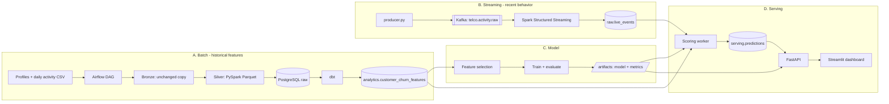

# Telco Hybrid Platform

An end-to-end **telecom customer churn platform** that combines a **batch pipeline** (Airflow, PySpark, dbt, PostgreSQL) with **real-time streaming** (Kafka, Spark Structured Streaming), trains a reusable churn model on the Gold features, and serves predictions through **FastAPI** and a **Streamlit** dashboard.

Built for the Route Academy LLMOps Assignment 05. The goal is correct data flow, integration and reproducibility, not the highest model accuracy.

## Architecture



**Data layers**

| Layer | What it holds | Where |
|---|---|---|
| Bronze | Unchanged copies of the source CSV files | `data/bronze/` |
| Silver | Cleaned data, grouped per customer per day (Parquet) | `data/silver/` |
| PostgreSQL `raw` | Queryable warehouse inputs and live events | `raw.customers`, `raw.daily_activity`, `raw.live_events` |
| Gold | One feature row per customer, built by dbt | `analytics.customer_churn_features` |
| Serving | Latest churn score per customer | `serving.predictions` |

**Why each tool is used**

- **Airflow** schedules the daily batch DAG. The streaming job is *not* run inside Airflow because it never ends.
- **PySpark** handles the 1M+ row batch (clean, deduplicate, aggregate) and the Kafka stream.
- **dbt** builds and tests the Gold feature table from warehouse data. It is not re-run per Kafka event.
- **Kafka** decouples event producers from the consumer and keeps events keyed by customer.
- **PostgreSQL** is the single store for raw, Gold and serving tables.
- **scikit-learn pipeline** keeps preprocessing and model in one saved artifact, so the scoring worker and the API both reuse exactly the same model without retraining.
- **FastAPI / Streamlit** expose predictions to applications and business users.

## Tech stack

| Layer | Tools |
|---|---|
| Orchestration | Apache Airflow 3 |
| Batch processing | PySpark 3.5 |
| Transformation | dbt (dbt-postgres) |
| Database | PostgreSQL 16 (`raw`, `analytics`, `serving` schemas) |
| Streaming | Apache Kafka, Spark Structured Streaming |
| ML | scikit-learn, pandas, joblib |
| Serving | FastAPI, Uvicorn |
| Dashboard | Streamlit |
| Tooling | Docker Compose, uv, ruff, black, pre-commit, pytest, GitHub Actions |

## Project structure

```
.
├── dags/
│   ├── 01_data_pipeline.py          # daily batch: bronze -> silver -> postgres -> dbt gold -> validate
│   └── 02_ml_training_pipeline.py   # manual: check gold -> features -> train -> evaluate -> save
├── src/
│   ├── etl.py                       # PySpark ETL: Bronze, Silver, load to PostgreSQL
│   ├── setup_topics.py              # creates the Kafka topic telco.activity.raw
│   ├── producer.py                  # reads an activity CSV and publishes keyed events to Kafka
│   ├── streaming_processor.py       # Spark Structured Streaming: Kafka -> raw.live_events
│   ├── feature_selection.py         # ANOVA F-test (filter) feature selection
│   ├── train.py                     # split, fit pipeline, evaluate, save artifacts
│   ├── model_service.py             # loads the saved model, predict + risk level (no training)
│   ├── scoring_worker.py            # Gold + live aggregates -> serving.predictions
│   ├── api.py                       # FastAPI application
│   └── dashboard.py                 # Streamlit dashboard
├── dbt/telco/                       # dbt project (Gold models, sources, tests)
├── data/
│   ├── batch_data/                  # source CSVs (not committed)
│   └── stream_data/generate_data.py # dataset / daily-file generator
├── artifacts/                       # churn_model.joblib, metrics.json, feature_selection.json
├── tests/                           # pytest suite (API + model service)
├── init.sql                         # schemas and tables (raw, analytics, serving)
├── docker-compose.yml               # postgres + kafka + airflow
├── Dockerfile                       # Airflow image (Java, PySpark, Kafka client)
├── Dockerfile.postgres              # PostgreSQL image (runs init.sql)
├── pyproject.toml / uv.lock         # reproducible Python environment
└── .github/workflows/ci.yml         # ruff + black + pytest
```

## Dataset notes

Synthetic data, no real customer information (seed 42).

- **Observation window:** 2026-11-09 to 2026-11-20 (12 days).
- **Size:** 120,000 customer profiles and 1,020,000 activity events (85,000 per day).
- **Target:** `churned` (0/1) exists **only** in the profile file. It never appears in Kafka events or prediction requests.
- **Join key:** `customer_id`.

`customer_profiles.csv`: `customer_id, age, region, plan_type, contract_type, tenure_months, monthly_fee, autopay, churned`

`activity_YYYY-MM-DD.csv`: `event_id, customer_id, activity_date, usage_minutes, data_gb, support_call, late_payment`

**Model features (12):**

| Type | Features |
|---|---|
| Categorical (3) | `region`, `plan_type`, `contract_type` |
| Numeric (9) | `age`, `tenure_months`, `monthly_fee`, `autopay`, `avg_daily_minutes`, `avg_daily_data_gb`, `support_calls_30d`, `late_payments_30d`, `days_since_last_activity` |

**Live Kafka event** (topic `telco.activity.raw`, key = `customer_id`):

```json
{
  "event_id": "evt-demo-001",
  "customer_id": 1024,
  "event_type": "support",
  "usage_minutes": 0.0,
  "data_gb": 0.0,
  "created_at": "2026-11-21T10:00:00Z"
}
```

`event_type` is one of `usage`, `support`, `late_payment`. The stream derives the `support_call` and `late_payment` flags before storing events.

**Risk levels:** Low below 0.30, Medium from 0.30 to below 0.70, High from 0.70 upward. A score is not a real-world churn guarantee.

## Prerequisites

- Docker Desktop (running) and Docker Compose
- [uv](https://docs.astral.sh/uv/)
- Python 3.12 (`uv python install 3.12.7`)
- Java 17 only if you run Spark locally (outside Docker)

## Setup

```bash
# 1. Python environment
uv sync

# 2. Settings (copy the template, then edit the password if you want)
cp .env.example .env        # PowerShell: Copy-Item .env.example .env
```

`.env` contents (never committed):

```env
POSTGRES_USER=telco
POSTGRES_PASSWORD=telco123
POSTGRES_DB=telco
```

```bash
# 3. Start PostgreSQL, Kafka and Airflow
docker compose up -d --build
docker compose ps
```

| Service | Address |
|---|---|
| PostgreSQL | `localhost:5432` (schemas and tables created by `init.sql`) |
| Kafka (from host) | `localhost:29092` |
| Airflow UI | http://localhost:8081 |

Verify the database:

```bash
docker compose exec postgres psql -U telco -d telco -c "\dn"
docker compose exec postgres psql -U telco -d telco -c "\dt raw.*"
```

Expected schemas: `raw`, `analytics`, `serving`.

> **Local runs:** when a command is run from your machine (not inside a container) point it at the Docker services first.
> PowerShell: `$env:POSTGRES_HOST = "localhost"; $env:KAFKA_BOOTSTRAP = "localhost:29092"`
> Bash: `export POSTGRES_HOST=localhost KAFKA_BOOTSTRAP=localhost:29092`

## Run the platform (in order)

### 1. Generate the dataset (once)

```bash
uv run python data/stream_data/generate_data.py --customers 120000 --days 12 --events-per-day 85000
```

Creates `customer_profiles.csv` and 12 `activity_*.csv` files in `data/batch_data/`. Check that 13 files exist.

### 2. Batch workflow: CSV to Gold

**Option A: Airflow.** Open http://localhost:8081, un-pause and trigger the batch DAG `telco_data_pipeline`. Tasks: copy to Bronze, clean to Silver, load PostgreSQL, run and test dbt, validate Gold.

**Option B: manual.**

```bash
# Bronze -> Silver -> PostgreSQL raw
docker compose exec -w /opt/airflow/project airflow python -m src.etl

# dbt Gold
uvx --python 3.12 --from dbt-postgres dbt run  --project-dir dbt/telco --profiles-dir dbt/telco
uvx --python 3.12 --from dbt-postgres dbt test --project-dir dbt/telco --profiles-dir dbt/telco
```

Verify:

```bash
docker compose exec postgres psql -U telco -d telco -c "SELECT count(*) FROM raw.customers;"
docker compose exec postgres psql -U telco -d telco -c "SELECT sum(events_count), min(activity_date), max(activity_date) FROM raw.daily_activity;"
docker compose exec postgres psql -U telco -d telco -c "SELECT count(*), count(DISTINCT customer_id) FROM analytics.customer_churn_features;"
```

Expected: 120000 customers, 1020000 events (2026-11-09 to 2026-11-20), and 120000 Gold rows with 120000 distinct customers.

### 3. Model: feature selection, training, evaluation, saving

```bash
uv run python -m src.feature_selection
uv run python -m src.train
```

| Artifact | Content |
|---|---|
| `artifacts/feature_selection.json` | feature scores and the selected numeric features |
| `artifacts/churn_model.joblib` | fitted preprocessing + classifier (one pipeline) |
| `artifacts/metrics.json` | accuracy, precision, recall, F1, ROC-AUC and `model_version` |

Preprocessing and the model are fitted on the training split only. `model_service.py` loads the saved pipeline and never retrains.

### 4. Streaming: event to PostgreSQL

Run the three steps in separate terminals. The streaming job keeps running (it is intentionally **not** an Airflow task).

```bash
# 1) create the Kafka topic
uv run python -m src.setup_topics

# 2) generate a new day of events (written to data/stream_data/)
uv run python data/stream_data/generate_data.py --date 2026-11-21 --events-per-day 5000

# 3) Spark Structured Streaming: Kafka -> raw.live_events (keep running)
docker compose exec -w /opt/airflow/project airflow python -m src.streaming_processor

# 4) publish events (another terminal)
docker compose exec -w /opt/airflow/project airflow python -m src.producer --limit 100
```

Verify:

```bash
docker compose exec postgres psql -U telco -d telco -c "SELECT count(*) FROM raw.live_events;"
docker compose exec postgres psql -U telco -d telco -c "SELECT * FROM raw.live_events ORDER BY created_at DESC LIMIT 5;"
```

> On Windows, run the streaming job inside the Airflow container (Linux) as shown. Running Spark natively on Windows needs Hadoop `winutils`.

### 5. Hybrid scoring

The scoring worker merges each customer's Gold row with recent live-event aggregates (extra support calls and late payments, and a fresh activity flag), loads the saved model, and stores one latest row per customer in `serving.predictions`.

```bash
uv run python -m src.scoring_worker               # score all customers
uv run python -m src.scoring_worker --only-live   # only customers with live events
```

```bash
docker compose exec postgres psql -U telco -d telco -c "SELECT risk_level, count(*) FROM serving.predictions GROUP BY 1;"
docker compose exec postgres psql -U telco -d telco -c "SELECT * FROM serving.predictions ORDER BY updated_at DESC LIMIT 5;"
```

### 6. API and dashboard

```bash
# FastAPI on http://localhost:8000 (interactive docs at /docs)
uv run uvicorn src.api:app --port 8000

# Streamlit on http://localhost:8501 (new terminal)
uv run streamlit run src/dashboard.py
```

## The two demo flows

**Batch:** CSV -> Bronze -> Silver -> PostgreSQL raw -> dbt Gold -> model training -> `POST /predict`.

**Live:** event -> Kafka -> Spark Streaming -> `raw.live_events` -> scoring worker -> `serving.predictions` -> API -> dashboard.

## API

| Method | Path | Description |
|---|---|---|
| GET | `/health` | Service status and whether the model artifact is loaded |
| POST | `/predict` | On-demand churn prediction from the 12 model features |
| GET | `/predictions/recent` | Most recent stored predictions |
| GET | `/customers/{customer_id}/risk` | Stored risk for one customer |
| GET | `/analytics/summary` | Scored customer counts and risk breakdown |

`POST /predict` accepts only the 12 model features (no `churned`, no `customer_id`):

```json
{
  "region": "Cairo",
  "plan_type": "Basic",
  "contract_type": "Monthly",
  "age": 35,
  "tenure_months": 12,
  "monthly_fee": 200,
  "autopay": 1,
  "avg_daily_minutes": 50,
  "avg_daily_data_gb": 1.2,
  "support_calls_30d": 1,
  "late_payments_30d": 0,
  "days_since_last_activity": 2
}
```

Response shape: `{"prediction": 0 or 1, "churn_probability": 0.72, "risk_level": "High"}` (the probability is illustrative).

## Development

```bash
uv run ruff check .             # lint
uv run black .                  # format
uv run pytest -q                # tests
uv run pre-commit install       # enable git hooks
uv run pre-commit run --all-files
```

The GitHub Actions workflow (`.github/workflows/ci.yml`) runs ruff, black and pytest on every push and pull request. The tests do not need PostgreSQL, Kafka or the model file.

## Evidence checklist

Screenshots for the submission (`evidence/` folder):

- [ ] Both Airflow DAGs
- [ ] dbt Gold table and passing dbt tests
- [ ] A Kafka event stored in `raw.live_events`
- [ ] Saved model artifacts and `metrics.json`
- [ ] Stored churn score in `serving.predictions`
- [ ] FastAPI `POST /predict` response
- [ ] Streamlit dashboard
- [ ] Green GitHub Actions run

## Troubleshooting

| Problem | Fix |
|---|---|
| `failed to connect to the docker API` | Start Docker Desktop and wait for "Engine running". |
| `port is already allocated` (8080) | Airflow is published on host port **8081** (`8081:8080`). |
| `env file ... .env not found` | Create `.env` in the project root (see Setup). |
| `could not translate host name "postgres"` when running dbt or scripts locally | Set `POSTGRES_HOST=localhost`. |
| Docker init script did not create tables after editing `init.sql` | `docker compose down -v` then `up -d --build` (init runs only on an empty volume). |
| `no such file` / empty Dockerfile | Make sure files are saved and have no extension. |
| Kafka `NoBrokersAvailable` | Wait ~20 seconds after `up`, then retry. |
| Streaming job logs `winutils` errors on Windows | Run it inside the Airflow container as shown above. |
